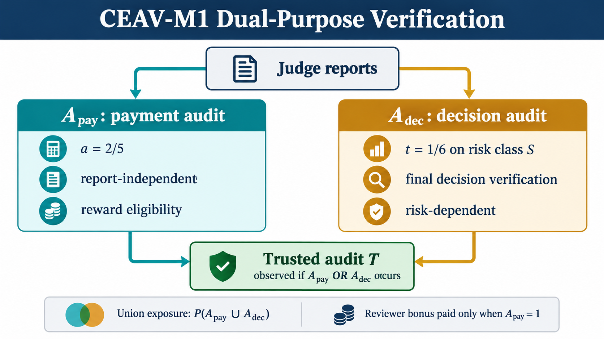
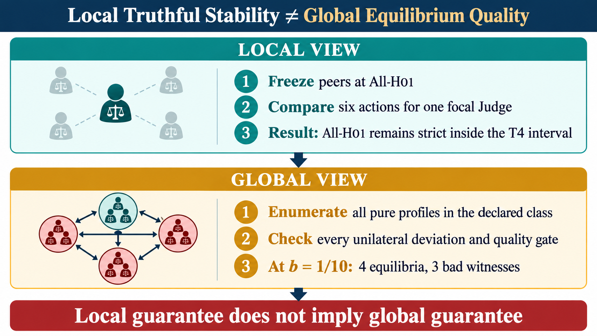

# Separating Payment and Decision Verification in Escrow Review

## Exact incentives, external release interests, and the pure-equilibrium quality boundary

**Manuscript version:** v0.2 editorial closeout

**Date:** 2026-10-24

**Frozen evidence baseline:** commit `58f2e0dc69bc0beefce4dc4b2d5b71d09c8711e5` on `research/v6-rave-phase01`
**Status:** research draft; not a submission-readiness or production-readiness claim

## Abstract

Escrow release systems ask reviewers to acquire costly information, report a
binary judgment, and influence a final payment decision. A trusted audit can
both reward reports and improve the decision, but tying audit eligibility to a
report can make the report seek the audit rather than describe the reviewer’s
information. This paper studies a frozen three-Judge escrow game with a public
signal, private noisy signals, a shared noisy audit, a binary release rule,
and explicit quality, cash, reserve, and audit-exposure gates.

The mechanism separates two purposes. A report-independent lottery determines
payment-audit eligibility; a risk-dependent lottery determines whether the
same trusted audit is observed for the final decision. Under neutral Judges,
exact calculation gives a strict effort margin and a conditional feasibility
region. Under external utility `b_i` for release, every unilateral utility
difference is affine in `b_i`. Exact rational interval enumeration shows that
the local truthful boundary is wider than the boundary on which every declared
pure stationary equilibrium satisfies the quality gates. At Selective
`b=1/10`, All-H01 remains strict while three strict bad equilibria coexist and
violate the false-approval gate.

The quantitative results are finite certificates for the stated game. The
paper does not claim a universal impossibility theorem, mixed-equilibrium
robustness, empirical audit accuracy, Sybil resistance, or production
readiness. The focused bibliography audit finds established prior art for
costly verification, report-sensitive checking, decision-interested experts,
and equilibrium multiplicity. The candidate contribution is the exact,
budget-constrained case study of separated payment and decision verification
and its external-interest quality boundary; priority remains open.

## 1. Research question and contribution

An escrow milestone has a hidden state `Y`: the promised work is acceptable or
not. A public signal `Z` is available to every reviewer. A Judge may buy a
private signal `X_i`, report a binary label, and influence release. The system
may also observe a trusted audit `T`. This creates two incentive questions.

First, can payment eligibility and decision verification be separated so that
a report cannot select the event that makes its matching reward available?
Second, if a Judge benefits directly from release, does local truthful
behavior imply that every equilibrium is safe for the escrow?

The paper makes four scoped contributions.

1. **Separation lemma.** An independent payment lottery factors out of the
   expected match reward, giving an exact effort threshold at neutral utility.
2. **Neutral feasibility proposition.** In the frozen signal environment,
   Selective decision auditing improves decision loss relative to matched-
   exposure Uniform auditing while the strict effort and all gates hold.
3. **Local external-interest boundary.** All-H01 is a strict best-response
   profile exactly on two rational intervals, one for each audit policy.
4. **Global pure-quality boundary.** Exhaustive exact interval enumeration
   finds bad pure stationary equilibria before the local All-H01 boundary is
   reached.

The earlier V3–V6 artifacts also record two negative mechanisms: audit-seeking
deviations when audit selection and rewards are both report-contingent, and
uninformative Low equilibria on branches with no marginal reporting payoff.
Those observations motivate the architecture but are not universal
impossibility results.

## 2. Related work and novelty boundary

Costly verification and collective decisions are established mechanism-design
problems. Ben-Porath, Dekel, and Lipman study allocation with costly
verification and no monetary transfers ([AER](https://www.aeaweb.org/articles?id=10.1257/aer.104.12.3779)).
Erlanson and Kleiner study costly verification in collective binary decisions
([Theoretical Economics](https://econtheory.org/ojs/index.php/te/article/viewArticle/3101)).

Gao, Wright, and Leyton-Brown study costly evaluations, peer prediction, and
limited access to noisy ground truth ([accepted manuscript](https://dspacemainprd01.lib.uwaterloo.ca/server/api/core/bitstreams/2cf2eab2-324c-402f-98eb-ee05f2a446f4/content)).
Zarkoob, Fu, and Leyton-Brown study report-sensitive spot checking in peer-
grading systems ([AAMAS paper](https://www.ifaamas.org/Proceedings/aamas2020/pdfs/p1593.pdf)).
Their work is direct prior art against claiming report-sensitive checking or
trusted spot checks as new in isolation.

Decision-interest is also established. Boutilier characterizes compensation
rules for self-interested experts whose reports affect a principal’s decision
([AAMAS paper](https://www.cs.toronto.edu/~cebly/Papers/Boutilier_aamas12.pdf)).
Chen, Wu, Wu, and Yang study learning to incentivize costly information
acquisition with proper scoring rules and a principal-agent model
([PMLR](https://proceedings.mlr.press/v202/chen23ah.html)).
Kong, Ligett, and Schoenebeck establish the distinction between truthful and
uninformative equilibria in binary peer prediction
([paper page](https://schoeneb.people.si.umich.edu/papers/PeerFocal.html)).
Kong and Schoenebeck study equilibrium selection and focality without
verification ([ITCS paper](https://drops.dagstuhl.de/storage/00lipics/lipics-vol094-itcs2018/LIPIcs.ITCS.2018.13/LIPIcs.ITCS.2018.13.pdf)).

The complete focused source comparison is in
[`CEAV_M1_NOVELTY_AUDIT_T3_T5.md`](CEAV_M1_NOVELTY_AUDIT_T3_T5.md), and exact
metadata for the corrected entries is in
[`CEAV_M1_BIBLIOGRAPHY_PRIMARY_CHECK.md`](CEAV_M1_BIBLIOGRAPHY_PRIMARY_CHECK.md).
The safe claim is that this paper studies a separated architecture and gives
an instance-level certificate. It does not claim “first,” universal
impossibility, or universal robustness.

## 3. Frozen model

### 3.1 State, signals, and actions

The hidden state is `Y in {0,1}` with prior `pi=P(Y=1)=1/2`. The public signal
`Z` has accuracy `7/10`; each private signal `X_i` has accuracy `4/5`; the
trusted audit `T` has accuracy `9/10`. Conditional on `Y`, these signals are
independent. The accuracies are synthetic inputs, not empirical measurements.

Each of three Judges chooses one action in each positive-probability public
branch `Z=z`:

```text
A = {L0, L1, H00, H01, H10, H11}.
```

`L0` and `L1` report a constant without buying `X_i`. Every High action pays
effort cost `c=1/20` and observes `X_i`. `H01` reports `X_i`, `H10` reverses
it, and `H00/H11` ignore it. A stationary strategy is a pair of branch-local
actions. Deviations are task-local and freeze all peer strategies.

### 3.2 Decision calibration

The calibration is computed under H01 peers and then frozen for every actual
strategy. With false-approval cost `C_FA=2` and false-rejection cost
`C_FR=1`, release is optimal when posterior odds for `Y=1` are at least two.

| `Z` | report sum | `g0` | `g1(T=0)` | `g1(T=1)` |
|---:|---:|---:|---:|---:|
| 0 | 0 | 0 | 0 | 0 |
| 0 | 1 | 0 | 0 | 0 |
| 0 | 2 | 0 | 0 | 1 |
| 0 | 3 | 1 | 1 | 1 |
| 1 | 0 | 0 | 0 | 0 |
| 1 | 1 | 0 | 0 | 1 |
| 1 | 2 | 1 | 0 | 1 |
| 1 | 3 | 1 | 1 | 1 |

Re-estimating this table after a deviation would define another game and is
not part of the study.

### 3.3 Separated lotteries and utility

Reports lock before hidden lotteries are revealed. The payment lottery is

```text
A_pay ~ Bernoulli(a), a=2/5,
```

independent of signals, reports, peers, and future `T`. The decision lottery
is independent of `A_pay`:

```text
Selective: d(Z,r)=1/6 only when Z=0 and sum(r)=2; otherwise 0.
Uniform:   d(Z,r)=19/1250 everywhere.
```

If either event occurs, one common `T` is observed and one audit cost
`kappa=1/4` is charged. The union exposure is

```text
e(Z,r)=P(A_pay or A_dec | Z,r)=a+(1-a)d(Z,r).
```

Only `A_pay` earns the matching reward:

```text
R_i=f+mu*A_pay*1{r_i=T},  mu=2, f=0.
```

Judge utility is

```text
U_i=E[R_i]-effort_cost_i+b_i*P(D_final=1).
```

`b_i` is utility for release in the same units as rewards. It is an analysis
parameter, not an enforced bound or a measured reviewer trait.



*Figure 1. Payment and decision audits have separate lotteries and objectives; a common trusted audit is observed on their union.*

## 4. Metric definitions and gates

All reported quality metrics use the strategy-induced joint distribution of
`(Y,D)`. The definitions are conditional where they must be conditional:

```text
FA = P(D=1 | Y=0),
FR = P(D=0 | Y=1),
WrongPayout = V * P(Y=0,D=1),
Loss = C_FA * P(Y=0,D=1) + C_FR * P(Y=1,D=0).
```

At the frozen prior and weights,

```text
P(Y=0,D=1) = pi_0*FA = FA/2,
P(Y=1,D=0) = pi_1*FR = FR/2,
```

where `pi_0=pi_1=1/2`. With `V=1`, `C_FA=2`, and `C_FR=1`,

```text
WrongPayout = FA/2,
Loss = 2*(FA/2) + 1*(FR/2) = FA + FR/2.
```

The quality and resource gates are

```text
FA <= 1/5, FR <= 1/4, WrongPayout <= 3/20,
ExpectedCash <= 4, UnionExposure <= 1/2, RewardReserve <= 6.
```

The reserve is the cap `3*mu=6`; it is not expected reward and is not
multiplied by an audit probability. Expected cash includes matching rewards
and one union audit charge.

## 5. Propositions and proofs

### Proposition 1 — Independent payment eligibility factors the reward

Assume `A_pay` is independent of the information used to choose the report,
the report is locked before the lottery is revealed, and `b_i=0`. For any
information set `I` and report `r` chosen from `I`,

```text
E[R_i | I,r] = f + mu*a*P(T=r | I).
```

Let

```text
M_L(z)=max_r P(T=r|Z=z),
M_H(z)=sum_x P(x|z) max_r P(T=r|Z=z,X=x).
```

Then High is strictly preferred to the best Low action exactly when
`mu*a*(M_H(z)-M_L(z))>c`.

**Proof.** Independence factors `A_pay` out of the conditional expectation.
For Low, maximize the match probability over a constant report. For High,
condition on each observed `X` and maximize again. High can copy the best Low
report, so the difference before cost is nonnegative. Subtract `c`. No
decision term enters when `b_i=0`. ∎

For the frozen signals, an independent Fraction enumeration gives
`M_L=33/50`, `M_H=37/50`, and `delta=2/25` in both branches. At `a=2/5`
and `mu=2`,

```text
mu*a*delta-c = 2*(2/5)*(2/25)-1/20 = 7/500 > 0.
```

This is a modal-label effort incentive. It is not a strictly proper scoring
rule for probability reports and it does not remove the `b_i` decision term.

### Proposition 2 — Conditional neutral feasibility

In the frozen signal environment, with neutral Judges, fixed calibration, and

```text
5/16 < a < 1/2,
0 < t <= (1/2-a)/(1-a),
u=(1-a)t,
```

the declared six-action game has unique pure stationary equilibrium All-H01,
all frozen gates pass, and Selective has strictly lower decision loss than
Uniform at matched exposure and the same equilibrium report distribution.

**Proof.** The exact effort calculation gives `delta=2/25`, so High strictly
beats best Low when `2*a*(2/25)>1/20`, equivalently `a>5/16`. The union
probability is `a+u` on the Selective risk class and `a` elsewhere; the stated
bound gives `a+u<=1/2`. Direct integration of the frozen decision tables gives
the gate expressions in the theorem catalog. At equal exposure and reports,
the loss difference is

```text
u*(57/625)*(47/95 - 477/6250) > 0.
```

The strict effort inequality makes H01 unique in every branch, so the
equilibrium is unique in the declared class. At the excluded boundary
`a=5/16`, all-Low can tie and has `FA=FR=3/10`; strictness is therefore
required. Full algebra and the gate expressions are archived in the theorem
catalog §4 and the parent synthesis memo. ∎

### Proposition 3 — Exact local external-interest boundary

Freeze H01 peers and the two decision tables. All-H01 is a strict best
response in both branches exactly on:

| Mechanism | Strict interval for each `b_i` |
|---|---|
| Selective | `-70/633 < b_i < 175/1102` |
| Uniform | `-218750/2070709 < b_i < 218750/1365587` |

**Proof.** For each branch and action, write the deviation gap as
`intercept+b_i*slope`. The binding Selective rows are

```text
Z=0,L0: -7/500 -(633/5000)b_i >= 0,
Z=1,L1: -7/500 +(551/6250)b_i >= 0.
```

The Uniform binding rows have slopes `-2070709/15625000` and
`1365587/15625000`. Intersecting every remaining six-action inequality gives
weaker bounds. The exact local-deviation rows are stored in the immutable
boundary certificate and independently recomputed in the proof-review
runner. Endpoints are ties; immediately outside them the binding deviation is
profitable. ∎

This is a local statement with peers fixed at H01. The conservative condition
`|b_i|<7/500` is sufficient against arbitrary peer profiles because the
neutral effort gap is at least `7/500` and release probability changes by at
most one. Neither interval is enforced by the mechanism.

### Proposition 4 — Exact pure-equilibrium quality boundary

Consider stationary pure strategies, task-local unilateral deviations, and
predeclared preference vectors `000`, `100`, `010`, `001`, and `111`. For each
branch profile `p`, every deviation inequality is affine in the scalar `b`:

```text
c_i(p_i,z)-c_i(a_i,z)
 + b*v_i*(s_z(p)-s_z(a_i,p_-i)) >= 0.
```

The maximal all-pure gate-safe component containing zero is:

| Scenario | Selective | Uniform |
|---|---|---|
| `000` | all real `b` | all real `b` |
| one biased Judge | `(-70/633,+infinity)` | `(-218750/2070709,+infinity)` |
| `111` | `(-70/633,175/1922)` | `(-218750/2070709,109375/1189451)` |

**Proof.** There are `6^3=216` ordered profiles per branch. Intersect the
18 exact half-line constraints for each candidate, retaining closed endpoint
ties. A full equilibrium is a pair of branch intervals with nonempty
intersection. The independent audit checks 4,320 branch candidates and
466,560 full profiles across the two mechanisms and five scenarios. It also
checks every metric, gate, interval cell, and worst-equilibrium witness.

For the Selective symmetric scenario, the profile pair

```text
Z=0: (H01,H01,H01)
Z=1: (L1,L1,H01)
```

and its three Judge permutations is an equilibrium on
`[175/1922,7/46]`. At `b=1/10`, these three bad equilibria coexist with
strict All-H01. Their `FA=1391/6250>1/5`. Thus local All-H01 stability does
not imply all-equilibrium quality. ∎

The proposition does not cover mixed, correlated, coalition-proof, sequential,
Sybil, participation, or arbitrary heterogeneous `b in R^3` equilibria.

## 6. Exact baseline and strategic witnesses

The following tables use conditional `FA` and `FR`; the audit runner verifies
every equilibrium row in the immutable certificate satisfies the definitions
in §4.

### 6.1 Neutral All-H01 baseline

| Mechanism | FA | FR | WrongPayout | Loss | Exposure | Expected cash | Reserve |
|---|---:|---:|---:|---:|---:|---:|---:|
| Selective | `43/1250` | `481/3125` | `43/2500` | `348/3125` | `2557/6250` | `46957/25000` | `6` |
| Uniform | `328691/9765625` | `3184297/19531250` | `328691/19531250` | `4499061/39062500` | `2557/6250` | `46957/25000` | `6` |

At neutral equilibrium the mechanisms have equal exposure and cash. Selective
has lower decision loss under the frozen selective risk class and decision
tables.

### 6.2 Positive external-interest witness at `b=1/10`

| Mechanism | FA | FR | WrongPayout | Loss | Exposure | Expected cash | Reserve | Failed gate |
|---|---:|---:|---:|---:|---:|---:|---:|---|
| Selective | `1391/6250` | `313/3125` | `1391/12500` | `852/3125` | `2557/6250` | `45357/25000` | `6` | `FA>1/5` |
| Uniform | `2148236/9765625` | `8571103/78125000` | `1074118/9765625` | `42942879/156250000` | `2557/6250` | `45357/25000` | `6` | `FA>1/5` |

The Selective row is one of three permutation-equivalent bad equilibria. The
truthful All-H01 profile remains strict at this same `b`, so this is a global
equilibrium-quality failure rather than a local best-response failure.

### 6.3 Negative external-interest witness

| Mechanism | FA | FR | WrongPayout | Loss | Exposure | Expected cash |
|---|---:|---:|---:|---:|---:|---:|
| Selective | `671/25000` | `853/3125` | `671/50000` | `4083/25000` | `411/1000` | `7387/4000` |
| Uniform | `413347/15625000` | `1126397/3906250` | `413347/31250000` | `2666141/15625000` | `2557/6250` | `46157/25000` |

Both rows are strategic witnesses at the negative boundary component. Their
different exposure and cash show why neutral matched exposure cannot be
carried over to different equilibrium report distributions.

All numbers in §§6.1–6.3 are checked by
[`verification/manuscript_editorial_audit.py`](../verification/manuscript_editorial_audit.py)
against certificate SHA-256
`fde3ad4745b37e270469aaec2692a51c83cbcf5db7fcb0a16938296a6e25b7d5`.

## 7. Earlier negative mechanisms

If a report-contingent audit probability `q(r)` is paired with an audit-
contingent matching reward, a deviation from `r_0` to `r_1` is profitable when

```text
q(r_1)*P(T=r_1|z) > q(r_0)*P(T=r_0|z),
```

under the equal-cost and conditional-independence assumptions of the earlier
lemma. Report dependence alone is not enough to prove failure: compensating
transfers or another score can reverse the inequality.

If a reachable branch has no audit, no marginal reporting payoff, no external
decision preference, and positive High cost, every all-Low profile is a branch
equilibrium and every High action is strictly worse. The report is
uninformative. A bad decision still requires a separate decision witness.

These are scoped diagnostics inherited from the V3–V6 synthesis and are not
universal impossibility statements.

## 8. Computational evidence and review status

The independent computational review is separate from external human peer
review. No external human referee has reviewed this manuscript. The two
computational checks are:

```text
python -X utf8 -m verification.manuscript_editorial_audit
python -X utf8 -m verification.independent_t3_t5_review
python -X utf8 -m unittest tests.test_dual_boundary -v
```

The editorial audit checks all 80 equilibrium metric rows in the immutable
certificate, verifies `WrongPayout=FA/2` and `Loss=FA+FR/2`, and matches every
baseline and witness table above. The proof-review runner checks the T3 effort
gap, T4 binding fractions, and the T5 exact interval replay. The focused test
suite runs ten tests and passes.

The computational evidence proves identity and exact finite calculations; it
does not prove that the synthetic signal accuracies describe real reviewers or
that the mechanism is economically viable in production.

## 9. Claim-to-evidence map

| Manuscript claim | Evidence location | Evidence type |
|---|---|---|
| Metric definitions and reductions | §4; `verification/manuscript_editorial_audit.py` | algebra plus exact certificate replay |
| Payment factorization and effort threshold | Proposition 1; proof-review runner T3 output | algebraic proof plus independent Fraction calculation |
| Neutral feasibility and Selective loss comparison | Proposition 2; theorem catalog §4; synthesis memo §6 | algebraic proposition and frozen finite calculation |
| Local Selective/Uniform `b` intervals | Proposition 3; boundary certificate `local_deviations`; independent review | exact affine inequalities and independent Fraction replay |
| Global pure-quality intervals | Proposition 4; boundary certificate `scenarios.*.safe_component_containing_zero` | exhaustive declared pure-class certificate |
| `b=1/10` bad witnesses | §6.2; certificate symmetric equilibria | exact witness rows, not simulation |
| Neutral baseline comparison | §6.1; certificate neutral All-H01 rows | exact certificate metrics |
| Negative witness comparison | §6.3; certificate symmetric negative witness rows | exact certificate metrics |
| Prior-art and title metadata | §2; `CEAV_M1_NOVELTY_AUDIT_T3_T5.md`; `CEAV_M1_BIBLIOGRAPHY_PRIMARY_CHECK.md` | primary-source bibliography audit |
| Empirical audit quality or reviewer cost | Not claimed here; `CEAV_M1_EMPIRICAL_TRUST_PROTOCOL.md` | protocol only, no measurement |

The immutable certificate is computational evidence, not independent human
peer review. A future human review should inspect the model, derivations,
certificate replay, and literature priority separately.

## 10. Limitations and conclusion

The game assumes known signal likelihoods, conditional independence, a trusted
noisy audit, fixed decision tables, a finite action class, and a declared
external-interest scenario. It does not model mixed or coalition equilibria,
Sybil identities, participation, audit capture, evidence correlation, or
settlement latency. Restricting `b` is a trust assumption, not a mechanism
enforcement result. The empirical trust protocol has not been run.

The defensible result is therefore a finite, exact case study. Independent
payment eligibility gives a strict neutral effort margin and avoids direct
audit-seeking eligibility manipulation. It does not eliminate decision-interest
manipulation. The Selective mechanism remains locally truthful at `b=1/10`
while its bad equilibria fail the false-approval gate. Local truthful stability
and global all-equilibrium quality must be reported as separate properties.



*Figure 2. A local best-response interval against frozen peers does not imply that every pure equilibrium satisfies the quality gates.*

This v0.2 editorial closeout corrects metric conditioning and bibliography
metadata while preserving the frozen model, parameters, historical studies,
and immutable certificates. It is a clean research draft, not a submission-
readiness or production-readiness decision.

## References

1. Boutilier, Craig. “Eliciting Forecasts from Self-interested Experts:
   Scoring Rules for Decision Makers.” In *Proceedings of the 11th
   International Conference on Autonomous Agents and Multiagent Systems
   (AAMAS 2012)*, pp. 737–744, 2012.
   [Primary paper](https://www.cs.toronto.edu/~cebly/Papers/Boutilier_aamas12.pdf)
2. Chen, Siyu, Jibang Wu, Yifan Wu, and Zhuoran Yang. “Learning to Incentivize
   Information Acquisition: Proper Scoring Rules Meet Principal-Agent Model.”
   In *Proceedings of the 40th International Conference on Machine Learning*,
   PMLR 202, pp. 5194–5218, 2023.
   [PMLR record](https://proceedings.mlr.press/v202/chen23ah.html)
3. Erlanson, Anna, and Andreas Kleiner. “Costly Verification in Collective
   Decisions.” *Theoretical Economics* 15, 923–954, 2020.
   [Journal record](https://econtheory.org/ojs/index.php/te/article/viewArticle/3101)
4. Gao, Siyu, James R. Wright, and Kevin Leyton-Brown. “Incentivizing
   Evaluation with Peer Prediction and Limited Access to Ground Truth.”
   *Artificial Intelligence* 275, 618–638, 2019.
   [Accepted manuscript](https://dspacemainprd01.lib.uwaterloo.ca/server/api/core/bitstreams/2cf2eab2-324c-402f-98eb-ee05f2a446f4/content)
5. Zarkoob, Hedayat, Hu Fu, and Kevin Leyton-Brown. “Report-Sensitive
   Spot-Checking in Peer-Grading Systems.” In *Proceedings of the 19th
   International Conference on Autonomous Agents and Multiagent Systems
   (AAMAS 2020)*, pp. 1593–1601, 2020.
   [Primary paper](https://www.ifaamas.org/Proceedings/aamas2020/pdfs/p1593.pdf)
6. Kong, Yiling, Jennifer Ligett, and Grant Schoenebeck. “Putting Peer
   Prediction Under the Micro(economic)scope and Making Truth-telling Focal.”
   [Author paper page](https://schoeneb.people.si.umich.edu/papers/PeerFocal.html)
7. Kong, Yiling, and Grant Schoenebeck. “Equilibrium Selection in Information
   Elicitation without Verification via Information Monotonicity.” *ITCS*
   2018, DOI 10.4230/LIPIcs.ITCS.2018.13.
   [Primary paper](https://drops.dagstuhl.de/storage/00lipics/lipics-vol094-itcs2018/LIPIcs.ITCS.2018.13/LIPIcs.ITCS.2018.13.pdf)
